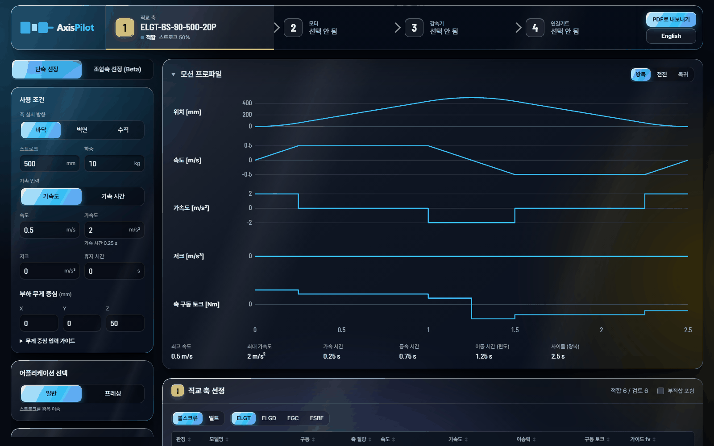

<p align="center">
  
</p>

<p align="center">
  Festo 직교축 · 모터 · 감속기 · 연결키트 선정 웹 앱<br>
  <a href="https://taeyoonkim0829.github.io/AxisPilot/"><b>앱 열기 → taeyoonkim0829.github.io/AxisPilot</b></a>
  · <a href="#english">English</a>
</p>



## 무엇을 하나요

이송 조건(스트로크, 속도, 가속도, 저크, 부하 질량, 부하 무게 중심, 설치 방향 바닥 / 벽면 / 수직)을 넣으면
주문할 수 있는 조합을 순서대로 고릅니다. 각 단계는 앞 단계의 선택을 바탕으로 합니다.

1. **직교 축**: Festo ELGT, ELGD, EGC (EGC-HD, ELGD-WD 포함), ESBF 전동 실린더
2. **모터**: Festo, Siemens, Mitsubishi. 서보 드라이브(CMMT, S210 / V90, MR-J5 / MR-J4), 모터 케이블,
   제동저항까지 함께 선정
3. **감속기**: 선택 사항 (직결 또는 맞는 감속기)
4. **연결키트**: Festo 모터-축 연결키트를 인터페이스 코드로 매칭하고 데이터시트 값으로 검토
5. **조합 도면**: 제조사 CAD 모델(STEP)을 조립한 3D 미리보기, STEP · DXF 내보내기

모든 검토 항목은 계산값, 허용값, 부하율과 함께 `적합` / `주의` / `부적합`으로 보여 줍니다. 결과만이 아니라
왜 맞는지를 화면과 보고서에서 확인할 수 있습니다.

## 주요 기능

- **단축 선정**과 **조합축 선정 (Beta)**: XYZ / YZ / XY 갠트리, 축 사이 Festo 키트 또는 주문 제작 브래킷
- **축 구성**: 2축 모터 동기, 2축 기구 동기(KSK 연결축), 축 + LM 가이드
- **프레싱 모드**: 접근 → 압착 → 유지 구간의 가압력을 계산에 반영
- **S커브 모션 프로파일**: 위치, 속도, 가속도, 저크, 토크 그래프와 사이클 전체의 실효 토크 · 회생 에너지
- **축 주문 옵션**: 모듈러 스트로크, 추가 슬라이드, 벨트 재질
- **PDF 계산서**: 입력, 모션 프로파일, 축, 모터, 드라이브, 감속기, 연결키트 검토. 같은 계산을 웹에서 다시
  여는 링크 포함
- **한국어 / English** 화면 전환

## 누구를 위한 앱인가요

- 고객 문의를 받아 축, 모터, 감속기, 연결키트를 골라 견적을 내는 영업 · 애플리케이션 엔지니어
- 엔지니어와 함께 화면을 보며 조합이 왜 맞는지 확인하는 고객사 기계 설계자

## 실행

웹에서 바로 쓰려면 [GitHub Pages](https://taeyoonkim0829.github.io/AxisPilot/)를 여세요. 백엔드가 없는
브라우저 전용 앱이라 설치할 것이 없습니다.

로컬에서 실행하려면 [Node.js](https://nodejs.org/)가 필요합니다.

```bash
npm install
npm run dev      # 개발 서버, http://localhost:5173
npm run build    # 타입 검사 + 빌드 (dist/)
npm test         # 단위 테스트 (vitest)
npm run lint     # oxlint
```

Windows에서는 `AxisPilot.bat`을 실행하면 개발 서버를 띄우고 브라우저를 엽니다. `main`에 푸시하면
GitHub Actions가 빌드해 Pages에 배포합니다.

## 구조

| 경로 | 내용 |
|---|---|
| `data/` | 제품 데이터 JSON (축, 모터, 감속기, 키트, 드라이브, 케이블 …)과 CAD 모델. 손으로 관리하는 원본, 필드와 단위는 [`data/README.md`](data/README.md) |
| `src/calc/` | 선정 계산 (SI 단위, 단위 테스트) |
| `src/cad/` | STEP 조립, 축 길이 보정, 3D 메시, DXF |
| `src/ui/` | React 화면, 보고서 |
| `src/i18n/` | 한국어 / 영어 |
| `scripts/festo-cad/` | Festo CAD 모델 정리와 조립 기준 좌표(frame JSON) 생성 |

디자인 시스템은 [`DESIGN.md`](DESIGN.md), 사용자와 제품 목적은 [`PRODUCT.md`](PRODUCT.md)에 있습니다.

## 참고

- 제품 데이터는 제조사 데이터시트를 바탕으로 직접 입력했습니다. 주문 전에는 제조사 자료로 결과를 확인하세요.
- CADENAS에서 받은 Festo CAD 파일은 CC BY-ND 4.0입니다. 조립은 원본을 그대로 쓰고, 스트로크에 맞춘 길이
  보정만 축 프로파일 형상을 바꿉니다.

---

## English

**AxisPilot** sizes and selects a Festo Cartesian axis and its drive train from the transport conditions: stroke,
velocity, acceleration, jerk, payload, payload centre of gravity and mounting (floor, wall, vertical).

1. **Axis**: Festo ELGT, ELGD, EGC (incl. EGC-HD, ELGD-WD), ESBF electric cylinder
2. **Motor**: Festo, Siemens, Mitsubishi, with the servo drive, motor cables and braking resistor
3. **Gearbox**: optional
4. **Motor–axis mounting kit**: matched by interface code, checked against its data sheet values
5. **Combination drawing**: the makers' STEP models assembled, 3D preview, STEP and DXF export

Every check shows the calculated value, the limit and the load ratio as ok / warn / fail. Also: gantries
(XYZ / YZ / XY, Beta), twin axes and LM guides, a pressing mode, S-curve motion profiles, and a PDF calculation
report with a link back to the calculation. The UI is Korean with an English toggle.

Open it at **[taeyoonkim0829.github.io/AxisPilot](https://taeyoonkim0829.github.io/AxisPilot/)**, or run it
locally with `npm install` and `npm run dev`. Product data is maintained by hand from the makers' data sheets:
check the results against the makers' documentation before ordering.

<p align="center"><sub>© Kim Taeyoon</sub></p>
