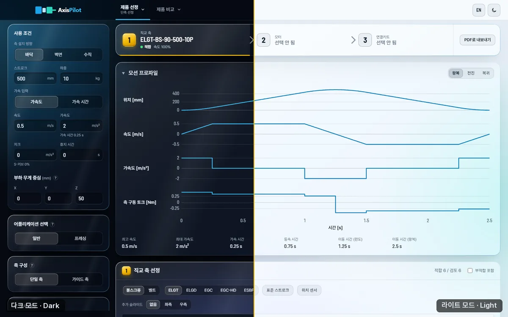
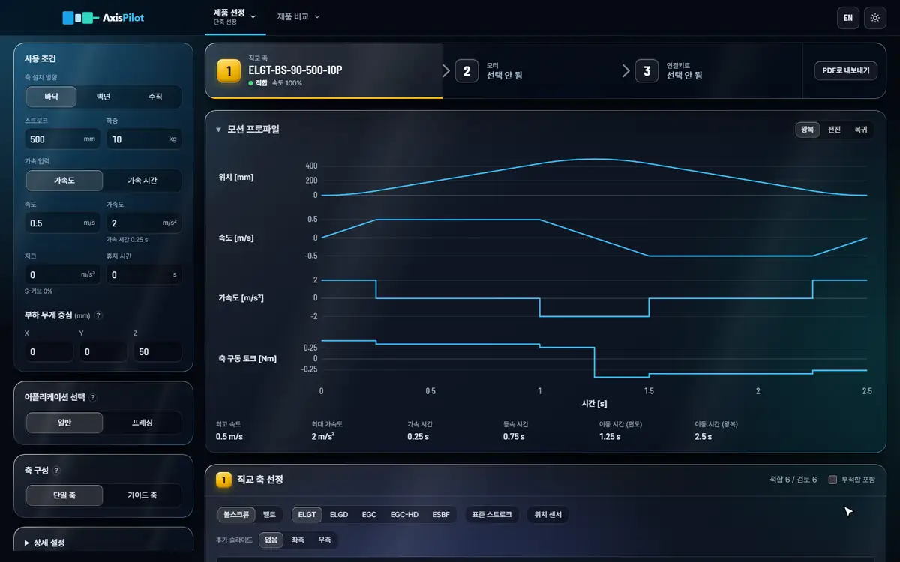

<p align="center">
  
</p>

<p align="center">
  Festo 직교축 · 모터 · 감속기 · 연결키트 선정 웹 앱<br>
  <a href="https://taeyoonkim0829.github.io/AxisPilot/"><b>앱 열기</b></a>
  · <a href="#english">English</a>
</p>

<p align="center">
  <a href="https://taeyoonkim0829.github.io/AxisPilot/theme-compare/">
    
  </a><br>
  <sub>다크 / 라이트 모드: 노란 막대 왼쪽이 다크, 오른쪽이 라이트. 이미지를 누르면 직접 끌어 비교할 수 있습니다. ·
  Dark / light theme: dark left of the yellow bar, light right of it. Click the image to drag it yourself.</sub>
</p>

## 무엇을 하나요

이송 조건(스트로크, 속도, 가속도 또는 가속 시간, 저크, 부하 질량, 부하 무게 중심, 설치 방향 바닥 / 벽면 / 수직)을
넣으면 주문할 수 있는 조합을 순서대로 고릅니다. 각 단계는 앞 단계의 선택을 바탕으로 합니다.

1. 직교 축
   - Festo ELGT, ELGD, EGC, EGC-HD, ESBF 전동 실린더
2. 모터
   - Festo (EMMT-AS, EMMT-EC, EMMB-AS, EMMT-ST, EMMB-ST)
   - Siemens (1FK2, 1FL6)
   - Mitsubishi (HK, HG)
   - LS Mecapion (APM)
   - 서보 드라이브(CMMT, S210 / V90, MR-J5 / MR-J4, L7NH), 모터 케이블, 제동저항까지 함께 선정.
3. 감속기
   - 선택 사항 (직결 또는 맞는 Festo EMGA / Apex 감속기)
4. 연결키트
   - Festo 모터-축 연결키트를 인터페이스 코드로 매칭하고 데이터시트 값으로 검토
5. 조합 도면
   - 제조사 CAD 모델(STEP)을 조립한 3D 미리보기, STEP · DXF · PDF 도면 내보내기

모든 검토 항목은 계산값, 허용값, 부하율과 함께 `적합` / `주의` / `부적합`으로 보여 줍니다. 결과만이 아니라
왜 맞는지를 화면과 보고서에서 확인할 수 있습니다.

<p align="center">
  <br>
  <sub>단축 선정: 직교 축(벨트) → 모터 → 감속기 → 연결키트 → 도면 3D 미리보기 ·
  Single axis selection: axis (toothed belt) → motor → gearbox → mounting kit → 3D preview of the drawing.</sub>
</p>

## 화면

- **제품 선정 → 단축 선정**: 축 하나와 그 구동계
- **제품 선정 → 조합축 선정 (Beta)**: XYZ / YZ / XY 갠트리, 축 사이 Festo 키트 또는 주문 제작 브래킷, 조합 도면과
  간섭 검토
- **제품 비교 → 직교 축 / 모터**: 다른 제조사 제품(Robostar 축, Siemens / Mitsubishi / LS 모터)과 그것을 대신할
  Festo 제품을 데이터로 비교. 사양 비교는 레이더 차트 또는 게이지 바, PDF로 내보내기

## 주요 기능

- **축 구성**: 단축, 가이드 축 (Festo 가이드 축 또는 LM 가이드, ESBF에는 EAGF 가이드 유닛), 2축 모터 동기 ·
  2축 기구 동기 (KSK 연결축)
- **프레싱 모드**: 접근 → 압착 → 유지 구간의 가압력을 계산에 반영, 수직축은 압착 방향 선택
- **위치 센서**: Festo 또는 Omron 센서와 러그를 선정해 보고서와 도면에 반영 (ELGD, ELGT, EGC, ESBF)
- **S커브 모션 프로파일**: 위치, 속도, 가속도, 저크, 토크 그래프와 사이클 전체의 실효 토크 · 회생 에너지
- **축 주문 옵션**: 모듈러 / 표준 스트로크, 추가 슬라이드, 벨트 재질, ELGD 취부 방식, 스핀들 서포트
- **PDF 계산서**: 입력, 모션 프로파일, 축, 모터, 드라이브, 감속기, 연결키트 검토. 같은 계산을 웹에서 다시
  여는 링크(`?r=`) 포함
- **한국어 / English**, **다크 / 라이트 모드** 전환

## 누구를 위한 앱인가요

- 고객 문의를 받아 축, 모터, 감속기, 연결키트를 골라 견적을 내는 영업 · 애플리케이션 엔지니어
- 엔지니어와 함께 화면을 보며 선정 유효성을 확인하는 고객사 기계 설계자

## 실행

웹에서 바로 쓰려면 [GitHub Pages](https://taeyoonkim0829.github.io/AxisPilot/)를 여세요. 백엔드가 없는
브라우저 전용 앱이라 설치할 것이 없습니다.

로컬에서 실행하려면 [Node.js](https://nodejs.org/)가 필요합니다.

```bash
npm install
npm run dev      # 개발 서버, http://localhost:5173
npm run build    # 타입 검사 + 빌드 (dist/)
npm test         # 단위 테스트 (vitest)
npm run lint     # oxlint
```

Windows에서는 `AxisPilot.bat`을 실행하면 개발 서버를 띄우고 브라우저를 엽니다. `main`에 푸시하면
GitHub Actions가 빌드해 Pages에 배포합니다.

## 구조

| 경로 | 내용 |
|---|---|
| `data/` | 제품 데이터 JSON (축, 모터, 감속기, 키트, 드라이브, 케이블, 제동저항, 센서, 비교용 타사 축 …)과 CAD 모델. 손으로 관리하는 원본, 필드와 단위는 [`data/README.md`](data/README.md) |
| `src/calc/` | 선정 계산 (SI 단위, 단위 테스트, Festo Electric Motion Sizing 결과와 비교하는 테스트 포함) |
| `src/cad/` | STEP 조립, 축 길이 보정, 3D 메시, DXF · PDF 도면 |
| `src/ui/` | React 화면, 보고서 |
| `src/i18n/` | 한국어 / 영어 |
| `scripts/festo-cad/` | Festo CAD 모델 정리와 조립 기준 좌표(frame JSON) 생성 |

디자인 시스템은 [`DESIGN.md`](DESIGN.md), 사용자와 제품 목적은 [`PRODUCT.md`](PRODUCT.md)에 있습니다.

## 참고

- 제품 데이터는 제조사 데이터시트를 바탕으로 직접 입력했습니다. 주문 전에는 제조사 자료로 결과를 확인하세요.
- CADENAS에서 받은 CAD 파일은 CC BY-ND 4.0입니다. 조립은 원본을 그대로 쓰고, 스트로크에 맞춘 길이
  보정만 축 프로파일 형상을 바꿉니다.

---

## English

**AxisPilot** sizes and selects a Festo Cartesian axis and its drive train from the transport conditions: stroke,
velocity, acceleration (or acceleration time), jerk, payload, payload centre of gravity and mounting (floor, wall,
vertical).

1. **Axis**: Festo ELGT, ELGD, EGC (incl. EGC-HD, ELGD-WD), ESBF electric cylinder
2. **Motor**: Festo, Siemens, Mitsubishi, LS Mecapion, with the servo drive (CMMT, S210 / V90, MR-J5 / MR-J4, L7NH),
   motor cables and braking resistor; AC 380–480 V, AC 200–240 V, DC 48 V and DC 24 V supplies
3. **Gearbox**: optional (Festo EMGA, Apex)
4. **Motor–axis mounting kit**: matched by interface code, checked against its data sheet values
5. **Combination drawing**: the makers' STEP models assembled, 3D preview, STEP, DXF and PDF drawing export

Every check shows the calculated value, the limit and the load ratio as ok / warn / fail. Screens: single axis
selection, gantries (XYZ / YZ / XY, Beta), and product comparison (Robostar axes and Siemens / Mitsubishi / LS
motors against the Festo products that could replace them, as radar chart or gauge bars, PDF export). Also: axis
arrangements (guide axes or LM guides, EAGF guide unit on ESBF, twin axes), a pressing mode, position sensors
(Festo, Omron), axis order options (standard stroke, additional slides, ELGD mounting, spindle support), S-curve
motion profiles, and a PDF calculation report with a link back to the calculation. Korean UI with an English
toggle, dark and light theme.

Open it at **[taeyoonkim0829.github.io/AxisPilot](https://taeyoonkim0829.github.io/AxisPilot/)**, or run it
locally with `npm install` and `npm run dev`. Product data is maintained by hand from the makers' data sheets:
check the results against the makers' documentation before ordering.

<p align="center"><sub>© Kim Taeyoon</sub></p>
